# Cys's UI

A light, flat, gold-and-dark replacement UI for **WoW Classic Era**: one addon instead of a stack of them. It takes over from ElvUI without the weight. Every piece is a module you can switch on or off, and everything can be moved and resized.

> **Status: alpha.** Public testing is open: expect rough edges, and settings may change between versions. Built and played on Classic Era (1.15.9). It is also being prepared for **WoW Forever** (interface 16001, launching Nov 4, 2026); that side is untested until launch. Bug reports from both are very welcome (see [Reporting a bug](#reporting-a-bug)).

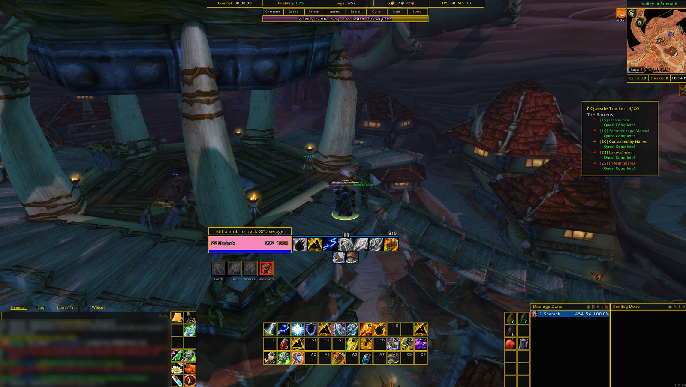

## What it can replace

| If you use | Cys's UI has |
| --- | --- |
| **ElvUI** | Action bars, unit frames, raid frames, chat, tooltips, minimap, info bars, XP bar, bags, nameplates, cast bars, group-loot boxes and skins for the Blizzard windows |
| **Plater / Platynator** | Flat nameplates: class and reaction colors, "mob is on you" coloring, your debuffs, a small cast bar and a gold target frame. It is not a scripting engine like Plater |
| **Postal** | Tick mails in the inbox (shift-click for a range), then Open or Return the ticked ones. Blizzard's Open All stays |
| **Pawn** | Scores gear with stat weights you choose, adds the score and "Upgrade / Downgrade / Side-grade" to item tooltips, and marks bag items that beat what you wear. Imports a [SixtyUpgrades](https://sixtyupgrades.com) CSV |
| **Bagnon / AdiBags** | One categorized, searchable, sortable bag window, plus a matching bank |
| **Titan Panel / bar addons** | An info bar with combat timer, guild and friends online, durability, bag slots, gold, FPS and latency, clock |
| **Chatter / Prat** | Flat chat with a Copy button, class-colored names, timestamps |

It plays well with **Details!**, **Questie**, **Postal**, **Plater** and **Platynator**, and has its own skins for Details! and Questie. `/cui` has a **Conflicts** page that lists what overlaps so you can turn one side off.

The full list of what each module does is in **[FEATURES.md](FEATURES.md)**.

## Install

1. Download the latest zip from the [Releases](../../releases) page.
2. Unzip it so the folder is named exactly **`CysUI`** and sits in `World of Warcraft\_classic_era_\Interface\AddOns\`.
3. Start the game and type **`/cui`**.

Running ElvUI too? Open the **Conflicts** page in `/cui`. Don't run two versions of the same piece (two action bars, two chat windows) at once.

## Commands

| Command | What it does |
| --- | --- |
| `/cui` | Settings window: a page per module, every feature has a switch |
| `/cui layout` | Layout mode: drag and resize every frame, snap to the grid |
| `/cui debug` | Prints client version and feature checks (include this in bug reports) |
| `/cui reload` | Reload the UI |
| `/cfriends` | Friends window |
| `/way 45 62 Name` | Drop a waypoint arrow (or Ctrl + left-click the world map) |
| `/cuilevel` | Show the level-up spell box now (`/cuilevel 30` previews level 30) |
| `/cuiscan` | At your class trainer: save its spell list and check the guide's levels |

## Screenshots

**In combat**

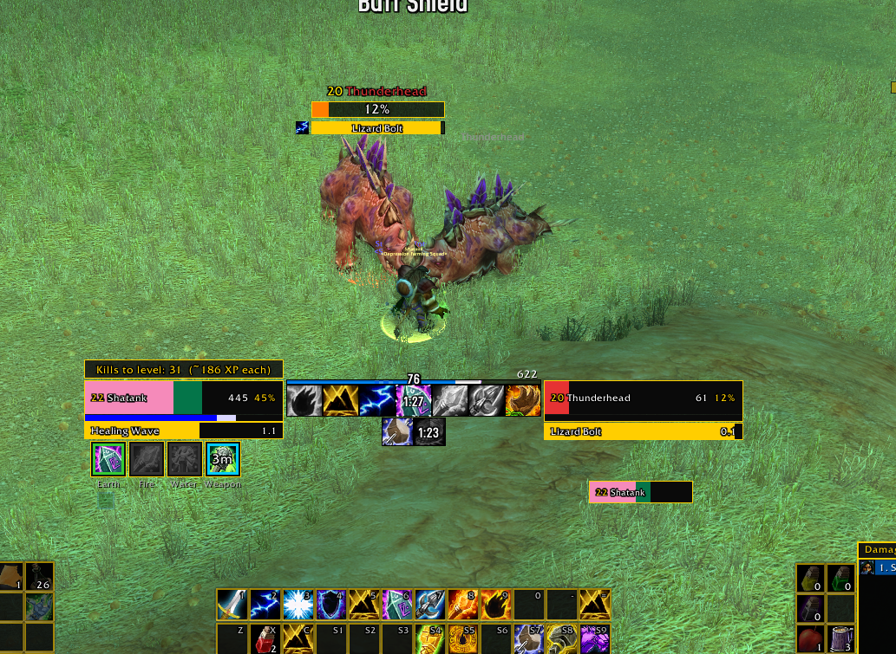

**Layout mode**: move and resize every frame

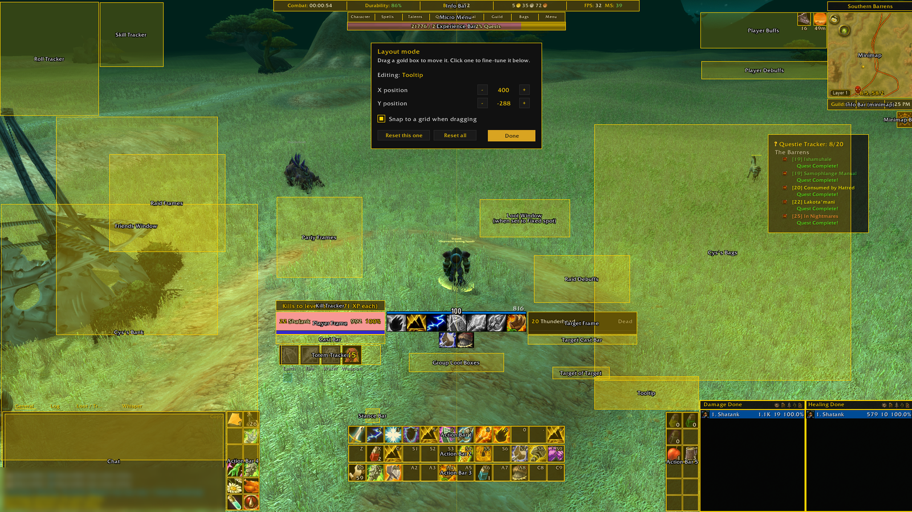

**Bags** and **Armory** (gear sets next to the character window)

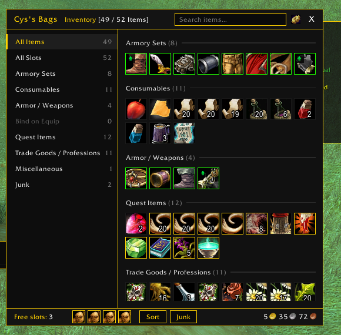 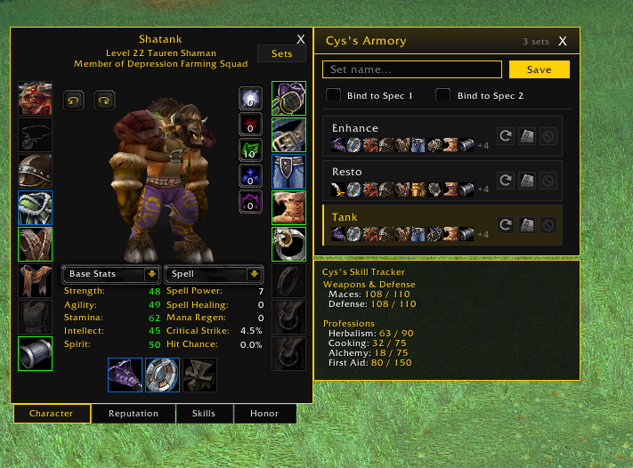

**Tooltips** with an item score, and **nameplates**

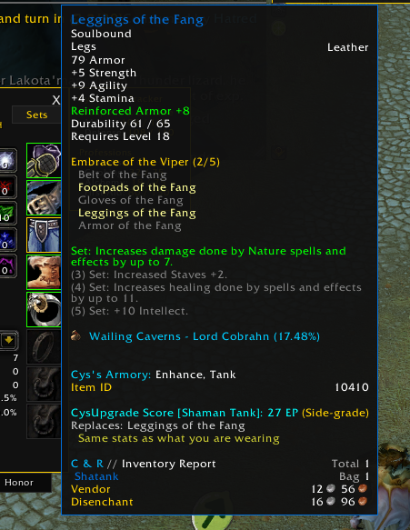 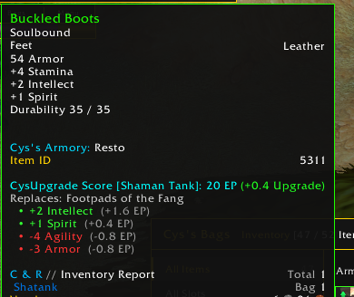

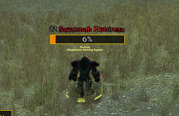

**Upgrade**: choose your stat weights, get an upgrade arrow on better gear

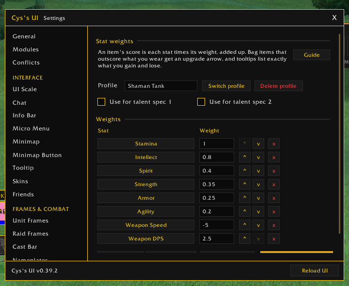 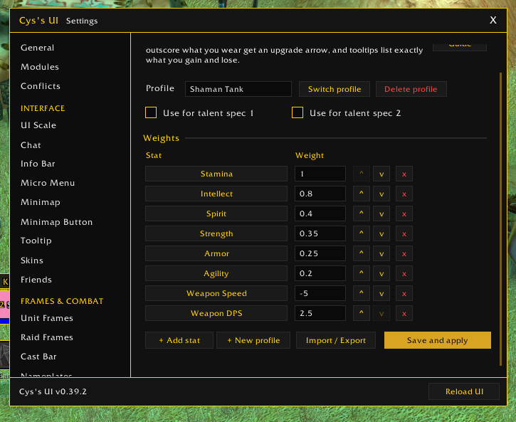

**Minimap button tray**: addon buttons collected into one tidy flyout

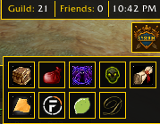

**Border color**: pick one for every frame edge (gold, class color, black, grey or shaman blue)

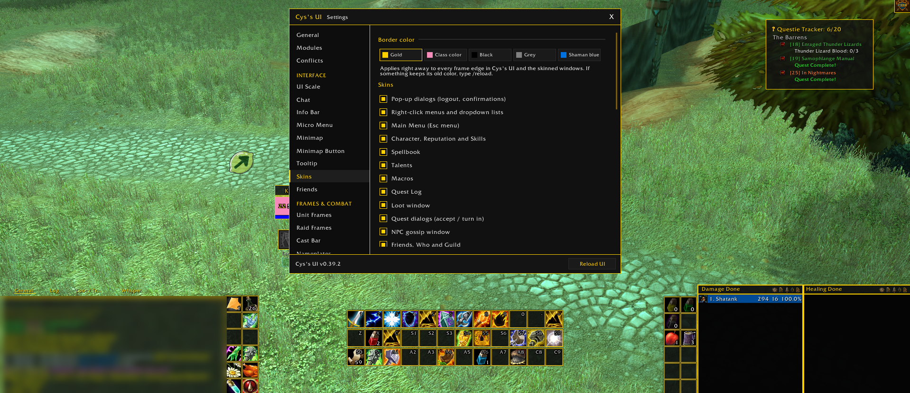 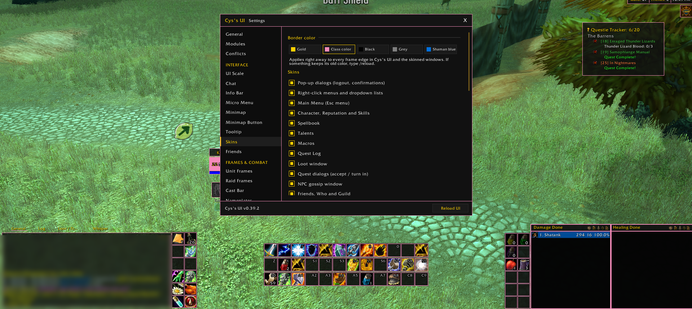
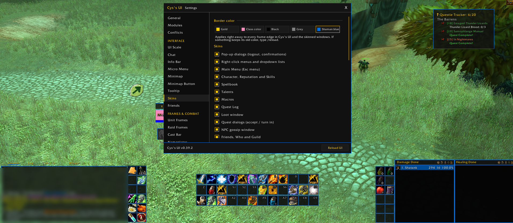 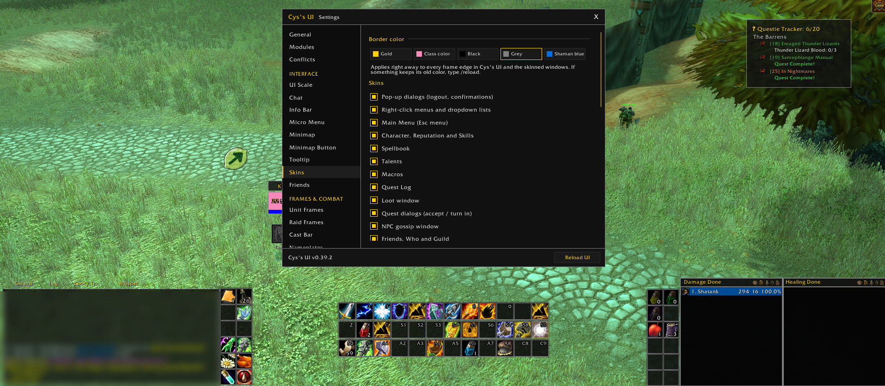
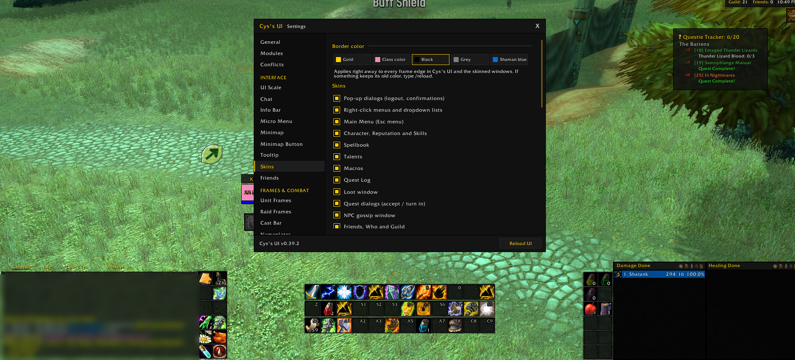

**Settings**: a switch for every module, with a memory light (green, yellow, red) and Export / Import / Debug tools

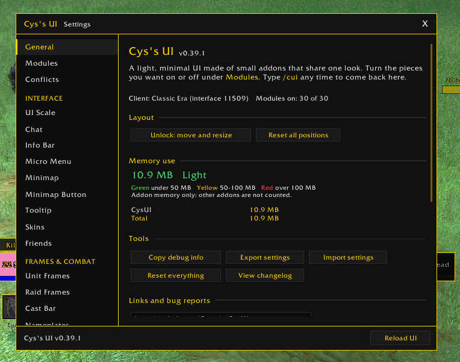

**Raid frames** for 10, 20 and 40 players

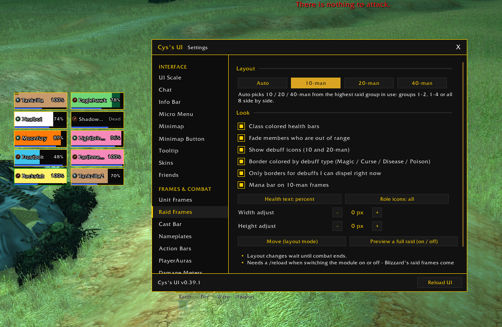
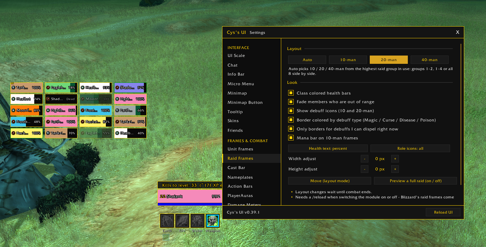
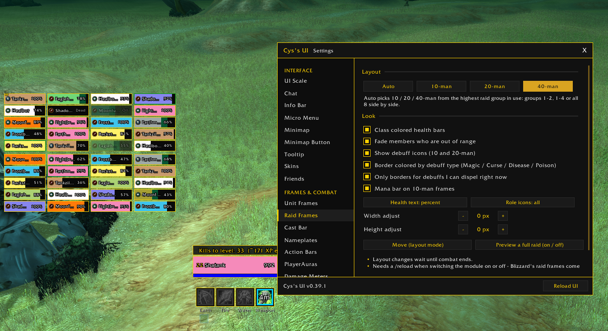

**Blizzard windows with the same look**

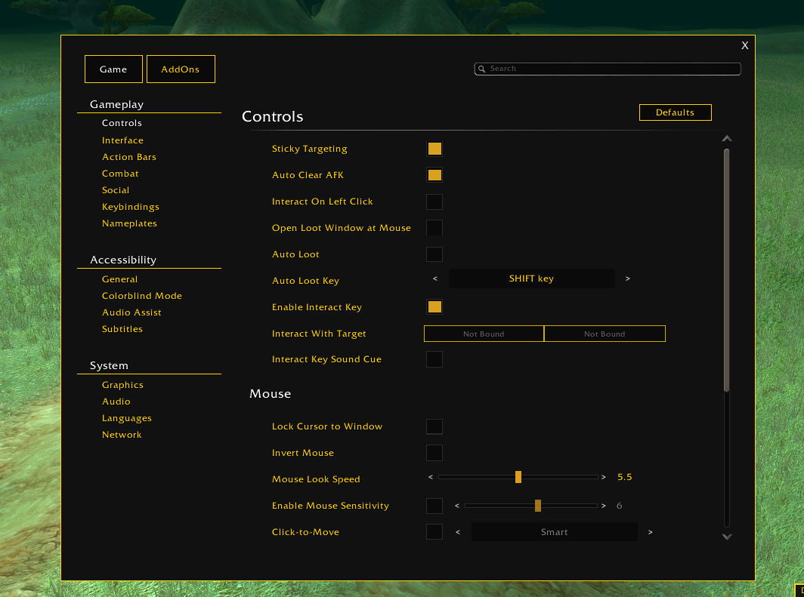

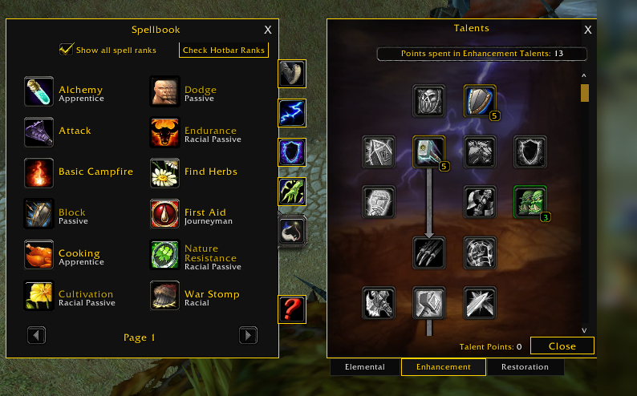 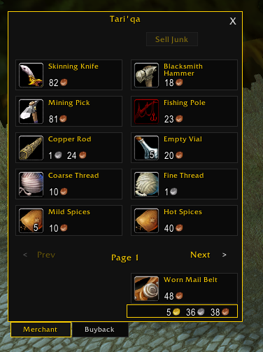

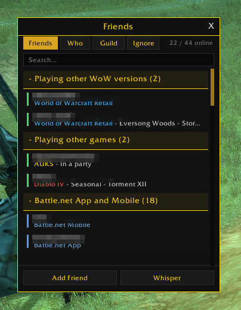 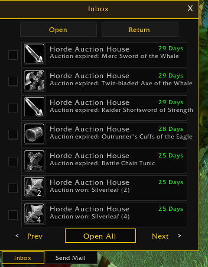 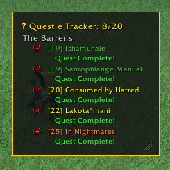

## Class support

Modules that depend on your class or spec. Anything not listed is on the list to add.

| Module | Class / spec | Client | State |
| --- | --- | --- | --- |
| Level-Up Spells | Shaman: Earth Warden (tank), Enhancement, Restoration | Era | in alpha, new in 0.41.0 |
| Level-Up Spells | Shaman: Elemental | Era | draft (uses the shared DPS list) |
| Level-Up Spells | every other class | Era | to add |
| Level-Up Spells | every class | WoW Forever | work in progress (no leveling guides out yet) |
| Totem bar | Shaman | Era | in alpha |
| Battle Shout alert | Warrior | Era | in alpha |
| Raid debuffs, interrupt announcer, waypoints, upgrade scores | every class | Era | in alpha |

## Help test: healing numbers

The heal and mana previews can be checked in game, at full health too. Type `/cuiheal`, cast a few heals (different ranks, on yourself or others), type `/cuiheal` again, then `/reload`. The log lands in `WTF\Account\<name>\SavedVariables\CysUI.lua` under `healLog`; send that file (or the `healLog` part) in your report. No damage needed: the log records what the preview said next to what the heal really did.

## Settings are per feature

Nothing is all-or-nothing. `/cui` has a switch for each module and for each skin, so if one thing doesn't suit you (or clashes with another addon) turn just that off. **Export settings** makes one line you can send to a friend, and **Import settings** loads theirs.

## Reporting a bug

Open an [issue](../../issues/new/choose) and pick **Bug report**. It asks for:
1. What you did and what you expected
2. The red error text, if any (a BugSack/BugGrabber screenshot is perfect)
3. The output of **Copy debug info** (`/cui` -> General -> Tools)
4. Whether you're on Classic Era or WoW Forever

Suggestions go the same way, under **Suggestion**. Screenshots of anything that looks off are the fastest way to get it fixed.

## Notes

- Saved variables: `CysUIDB` and one per module (`CysBagsDB`, `CysArmoryDB`, ...). To start fresh, use **Reset everything** in `/cui`, or delete them from `WTF\Account\<name>\SavedVariables` with the game closed.
- The Auction House module is not part of this release.

## Credits & license

Made by **Cyserin** (Cys). Released under the [MIT license](LICENSE).
